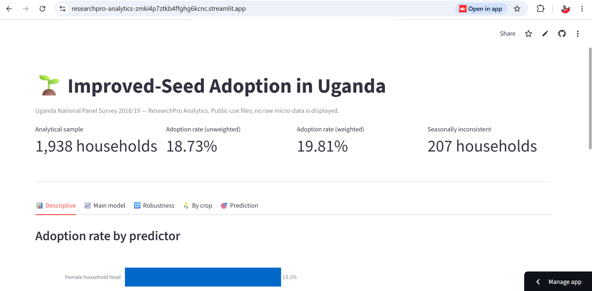

# ResearchPro Analytics


## 🔗 Live Dashboard

Explore the results interactively:



**[researchpro-analytics.streamlit.app](https://researchpro-analytics-zmki4p7ztkb4ffghg6kcnc.streamlit.app/)**

The dashboard surfaces the fitted logistic regression models,
crop-level seed-use patterns, and predictive performance metrics
from the committed reports. No raw micro-data is displayed.

---


**A portfolio project demonstrating survey data analysis, statistical inference, regression modelling, and responsible research practices.**

## Overview

ResearchPro Analytics is a reusable survey-analysis project designed to demonstrate practical statistical consulting and data analysis skills.

The first case study explores patterns associated with improved-seed adoption among agricultural households in Uganda, using agricultural and household information from the Uganda National Panel Survey (UNPS) 2018–2019.

The project demonstrates data assessment, cleaning, variable construction, exploratory analysis, statistical testing, logistic regression, predictive evaluation, and research reporting.

## Case Study

**Research question:** What household and institutional characteristics are associated with improved-seed adoption in the available survey data?

The analysis explores:

* Crop-level seed-use patterns.
* Participation in NAADS training programmes.
* Membership in farmer groups.
* Household-head age and sex.
* Associations between these characteristics and improved-seed adoption.
* Logistic regression and exploratory predictive modelling.

These findings are exploratory. Statistical associations do not prove causation.

## Data Source

The study uses the Uganda National Panel Survey 2018–2019, collected by the Uganda Bureau of Statistics with support from the World Bank.

Official resources:

* [UNPS 2018–2019 data catalogue and dictionary](https://microdata.worldbank.org/index.php/catalog/3795/data-dictionary)
* [World Bank Living Standards Measurement Study](https://www.worldbank.org/en/programs/lsms)

Obtain the dataset through an authorized source and follow its applicable access conditions and terms of use.

### Local Data Organisation

Place the authorized, extracted survey files under `data/raw/`, preserving the directory structure expected by the notebook. The analysis uses files including `AGSEC4A.csv`, `AGSEC9B.csv`, and `GSEC2.csv`.

The notebook will not run successfully until the required files are available in the expected locations.

Raw, processed, and external data directories are excluded from Git by default. Do not publish restricted microdata or identifiable records without authorization.

## Project Structure

```text
ResearchPro-Analytics/
├── data/
│   ├── raw/
│   ├── processed/
│   └── external/
├── notebooks/
│   ├── 01_environment_check.ipynb
│   ├── 02_dataset_assessment.ipynb
│   └── 02_dataset_assessment_public.ipynb
├── src/
├── reports/
├── dashboards/
├── tests/
├── docs/
├── requirements.txt
├── .gitignore
└── README.md
```

The original analysis notebook is retained separately from the public copy. Review notebooks and generated reports before publishing them.

## Getting Started

### Requirements

* Python 3.11 or later.
* Git.
* JupyterLab.
* Authorized access to the survey data to reproduce the analysis.

### 1. Clone the repository

```bash
git clone <YOUR-GITHUB-REPOSITORY-URL>
cd ResearchPro-Analytics
```

Replace the placeholder with your actual repository URL.

### 2. Create a virtual environment

On Windows PowerShell:

```powershell
py -m venv .venv
.venv\Scripts\Activate.ps1
```

### 3. Install dependencies

```powershell
python -m pip install --upgrade pip
python -m pip install -r requirements.txt
```

### 4. Start JupyterLab

```powershell
jupyter lab
```

Open `notebooks/02_dataset_assessment_public.ipynb` and run the cells from the beginning after placing the required survey files in the documented local data directory.

## Analytical Approach

The project uses:

* **Pandas and NumPy** for data preparation.
* **Matplotlib and Seaborn** for visualisation.
* **SciPy** for statistical tests.
* **Statsmodels** for statistical modelling and inference.
* **Scikit-learn** for exploratory predictive evaluation.
* **JupyterLab** for documented analysis.

The analysis distinguishes crop records from household-level observations and defines a household-level adoption outcome for modelling.

## Interpretation and Limitations

1. The survey's national scope does not make this analysis representative of Kibalinga Sub-County specifically.
2. The reported analyses are unweighted and do not fully account for the complex survey design. They should not be treated as definitive population estimates.
3. Observational associations do not establish causation.
4. Predictive performance is weak, so the model should not be presented as a reliable standalone decision tool.
5. Missing values may reflect survey skip patterns rather than negative responses.
6. Results depend on the variables, outcome definition, and complete-case selection used.

This project is a portfolio demonstration and a foundation for further methodological improvements, not a substitute for a fully design-adjusted survey analysis.

## Responsible Data Practices

* Follow dataset access conditions and licensing requirements.
* Keep restricted raw and record-level data out of public repositories.
* Check notebooks and reports for sensitive information before committing.
* Document data-cleaning and missing-data decisions.
* Distinguish exploratory findings from confirmatory conclusions.
* Report limitations alongside statistical results.

## Current Status

The project contains an initial agricultural technology
adoption case study, including:

- Exploratory analysis and descriptive statistics
- Chi-square association tests
- Logistic regression (baseline and expanded models)
- Exploratory predictive evaluation
- Weighted and unweighted point estimates
- A consolidated analysis report

A survey-design audit has been completed. It confirmed that:

- A cross-sectional weight (`wgt`) is available and used
  for weighted point estimates.
- Panel weights (`hwgt_W7`, `hwgt_wc`) are available with
  ~5.9% missingness and are reported as a sensitivity check.
- No PSU, cluster, or stratum identifiers are present in
  the public-use files.
- The community `EA_code` cannot be linked to household
  records because no shared key exists.
- The `batch` variable is a fieldwork enumeration code,
  not a sampling cluster.

As a result, reported standard errors and p-values are
**not design-based**. They are descriptive summaries of
the observed sample.

Future improvements may include design-adjusted estimates
using restricted-use files, additional diagnostics,
automated tests, reusable analysis functions, and a
dashboard.


## Running the Tests

The project includes an automated test suite that validates the
reusable modules in src/.

After installing dependencies, run:

    python -m pytest tests/ -v

Expected result: 25 tests pass, 0 fail.

The test suite covers:

- test_seed_outcome.py — validates the crop-level improved-seed
  outcome rules against the questionnaire coding.
- test_household_aggregation.py — validates the household-level
  adoption classification rules.
- test_modelling.py — validates the logistic regression and
  prediction-evaluation helpers.

## Data Availability

The raw survey microdata used in this project are **not** included
in this repository. The Uganda National Panel Survey (UNPS) 2018/19
is collected by the Uganda Bureau of Statistics with support from
the World Bank under the Living Standards Measurement Study —
Integrated Surveys on Agriculture (LSMS-ISA) program.

Researchers who wish to reproduce the analysis should obtain the
UNPS 2018/19 files through the official World Bank LSMS-ISA data
catalog (https://microdata.worldbank.org) and place them in a
local `data/raw/` directory. The project's `.gitignore` excludes
this directory to prevent accidental commits of restricted-use
or identifiable records.

The repository includes:

- All source code (`src/`)
- Test suite (`tests/`)
- Analytical reports (`reports/`)
- The analysis notebook (`notebooks/`), committed with outputs cleared
- The interactive dashboard (`dashboard/`)

Reported results can be verified against the public-use files
alone; no restricted-use identifiers are required to reproduce
any part of the committed analysis.
